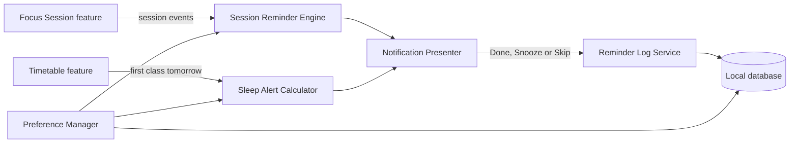
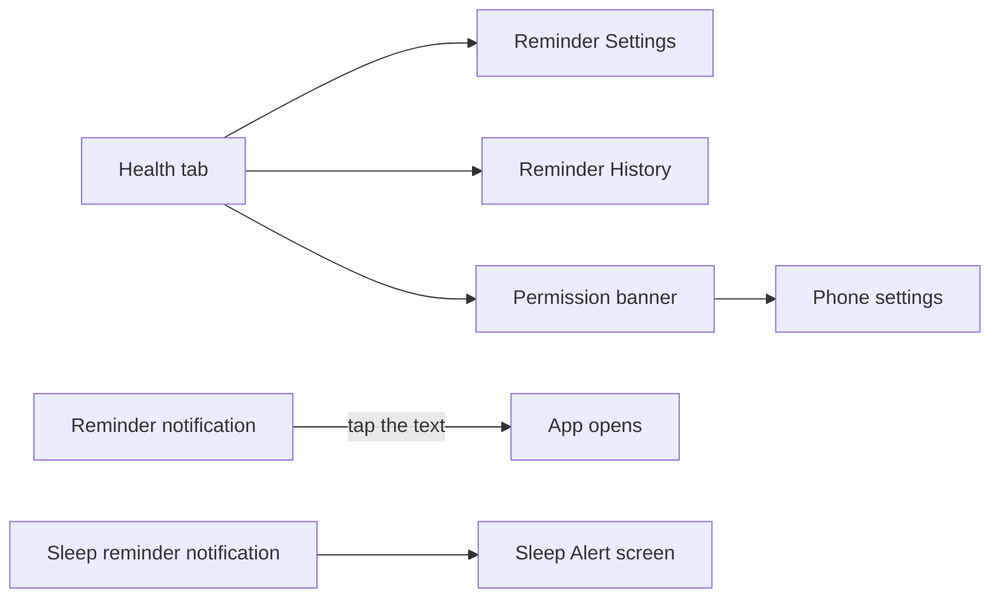
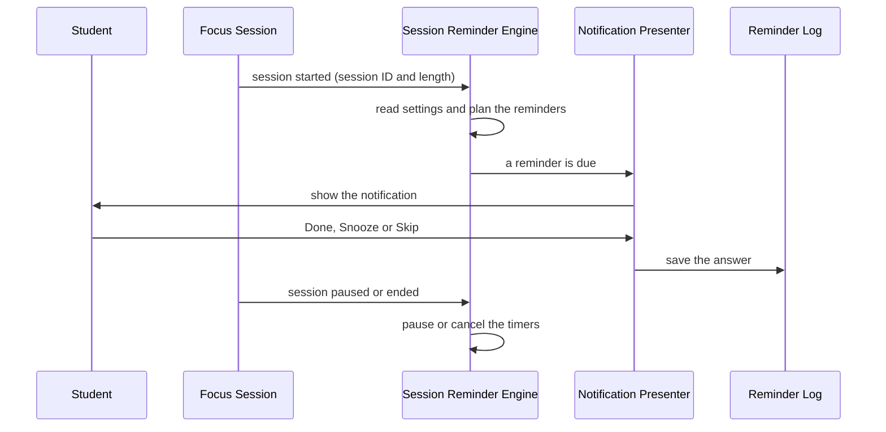
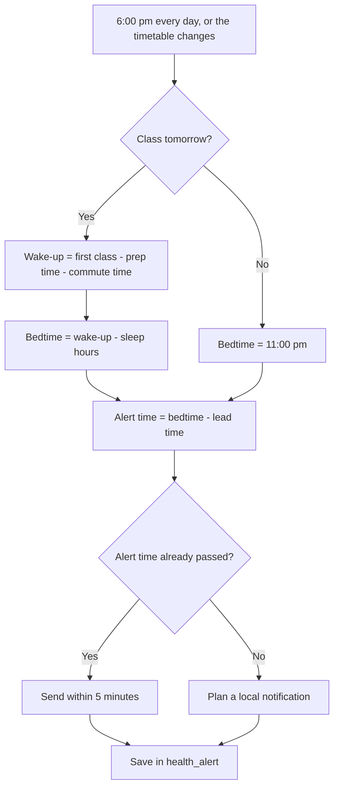
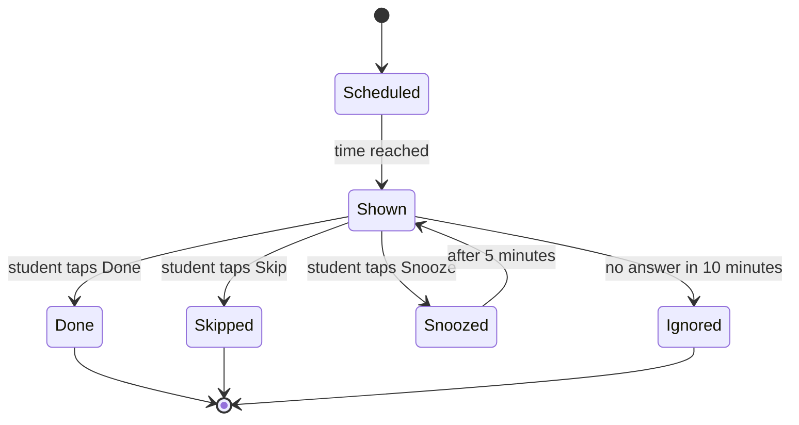

# Komore Design Document: Health Reminders and Notifications

**Section owner:** Student Wellness & Notifications
**Status:** Draft v1
**Related files:** `srs-health-notifications.md`, `reminder-rules.md`, `design-system.md`, `database-tables.md`, `Komore_Health_Wireframes.pdf`, `Komore_Health_ERD.pdf`

## 1. Introduction

### 1.1 Purpose
This section explains how the Health Reminders and Notifications feature of Komore is designed. It joins the screens, the database and the reminder logic into one document, and it shows how each requirement in the SRS is met.

### 1.2 Scope
The feature sends four kinds of local reminders: eye-rest, stretch, water (during focus sessions) and sleep (from tomorrow's first class). It also holds the student's reminder settings and a history of reminders.

## 2. Design overview

### 2.1 Main parts

| Part | Job |
|---|---|
| Session Reminder Engine | Plans and cancels eye-rest, stretch and water reminders while a focus session runs |
| Sleep Alert Calculator | Works out bedtime and the sleep reminder time from tomorrow's first class |
| Preference Manager | Reads and saves the student's settings and creates the default settings |
| Notification Presenter | Shows the notification and its Done, Snooze and Skip buttons |
| Reminder Log Service | Saves every reminder and the student's answer, and builds the history and weekly summary |
| Local database | Keeps the three tables on the phone so reminders work offline |

### 2.2 How the parts connect

### 2.3 What this feature needs from other features

| Event or data | From | Used for |
|---|---|---|
| Session started (session ID, length) | Focus Session | Start the interval timers |
| Session paused or resumed | Focus Session | Pause or continue the timers |
| Session ended or cancelled | Focus Session | Stop all session reminders |
| First class start time for tomorrow | Timetable | Sleep calculation |
| Tomorrow's first class changed | Timetable | Calculate the sleep reminder again |
| Student type | Onboarding and Profile | Default commute time |

This feature does not lock or unlock apps. It never talks to the App Lock or Photo Proof features.

## 3. Design system

All screens follow `design-system.md`.

| Item | Rule |
|---|---|
| Background | Cream `#F2E8DA` |
| Main text, main icons, dashboard | Brown `#3B2418` |
| Tappable icons | Baby blue `#8EC5FF` (a baby blue circle with a brown icon on cream) |
| Primary button | Brown fill, cream text |
| Secondary button | Baby blue fill, brown text |
| Font | The phone's own font (Roboto on Android, San Francisco on iPhone) |
| Touch targets | At least 48 x 48 |
| Reminder icons | Eye, stretching person, water drop and moon. They are told apart by shape, not by colour. |

## 4. User interface design

The wireframes are in `Komore_Health_Wireframes.pdf`.

### 4.1 Screens

| No. | Screen | Purpose | Requirements |
|---|---|---|---|
| 1 | Reminder Settings | Switches, intervals, sleep details, quiet hours | FR-HN-32 to FR-HN-37 |
| 2 | Reminder Notifications | The notification with Done, Snooze and Skip | FR-HN-24 to FR-HN-27, FR-HN-10 |
| 3 | Sleep Alert | Shows the bedtime and how it was worked out | FR-HN-15 to FR-HN-23 |
| 4 | Reminder History | Past reminders and the weekly summary | FR-HN-28 to FR-HN-31 |
| 5 | Health Home | Entry to the other screens and the permission banner | FR-HN-02, NFR-HN-05 |

### 4.2 Navigation

The student reaches the Reminder Settings in 2 taps (Health tab, then Reminder settings). This meets NFR-HN-05, which allows at most 3.

## 5. Database design

The ERD is in `Komore_Health_ERD.pdf`. The full column lists, rules, example data and SQL are in `database-tables.md`.

| Table | Rows | Purpose |
|---|---|---|
| `notification_preference` | 1 per student | Sleep hours, prep time, commute, lead time, quiet hours |
| `health_alert` | 4 per student | Reminder types, on/off switch, interval, and the calculated sleep reminder |
| `reminder_log` | Many | Every reminder shown and the student's answer |

## 6. Detailed design

### 6.1 Session reminders (eye-rest, stretch, water)

**Steps the engine follows**

1. When a session starts, read the enabled reminder types and their intervals.
2. For each type, plan the first reminder at (session start + interval). Skip a type if the session is shorter than its interval.
3. When a reminder is due:
   - Skip it if less than 2 minutes remain in the session, or if it falls inside quiet hours.
   - If another reminder is due within 5 minutes, combine them into one notification.
   - Otherwise show the notification and save a log entry.
4. After a reminder is shown, plan the next one at (now + interval).
5. When the session is paused, pause the timers. When it resumes, continue them.
6. When the session ends or is cancelled, remove all planned reminders.

### 6.2 Sleep alert

**Example:** first class at 8:00 am, prep 60 minutes, commute 45 minutes, sleep 8 hours, lead time 30 minutes.
Wake-up = 6:15 am. Bedtime = 10:15 pm. Alert = 9:45 pm.

### 6.3 What happens to one reminder

A reminder can be snoozed at most 2 times. After that, only Done and Skip are offered.

### 6.4 Settings changes
When the student changes a setting, the Preference Manager saves it, and the next reminder that is planned uses the new value (FR-HN-36). A switch that is turned off cancels planned reminders of that type. Each value is checked against its allowed range before it is saved (FR-HN-37).

### 6.5 Problems and how the app reacts

| Situation | What the app does |
|---|---|
| Notification permission refused | Show the banner on the Health tab with an Open settings button |
| Phone restarts | Plan the sleep reminder again (FR-HN-38) |
| Time zone or clock changes | Calculate the sleep reminder again (FR-HN-39) |
| Phone limits background work | Show a one-time tip to allow Komore to run in the background (FR-HN-40) |
| No internet | Everything still works, because the data and scheduling are on the phone |
| No class tomorrow, or no timetable | Use the default bedtime of 11:00 pm |
| Setting outside its allowed range | Show a clear message and keep the old value |

## 7. Requirement traceability

| Requirements | Part that meets them | Screen | Table |
|---|---|---|---|
| FR-HN-01 to FR-HN-03 | Preference Manager, Notification Presenter | Health Home | `notification_preference`, `health_alert` |
| FR-HN-04 to FR-HN-14 | Session Reminder Engine | Reminder Notifications | `health_alert`, `reminder_log` |
| FR-HN-15 to FR-HN-23 | Sleep Alert Calculator | Sleep Alert | `health_alert`, `notification_preference` |
| FR-HN-24 to FR-HN-27 | Notification Presenter | Reminder Notifications | `reminder_log` |
| FR-HN-28 to FR-HN-31 | Reminder Log Service | Reminder History | `reminder_log` |
| FR-HN-32 to FR-HN-37 | Preference Manager | Reminder Settings | `notification_preference`, `health_alert` |
| FR-HN-38 to FR-HN-40 | Sleep Alert Calculator, Notification Presenter | Health Home | `health_alert` |
| NFR-HN-02, NFR-HN-04 | Local database, phone scheduling | | All three tables |
| NFR-HN-05 | Navigation (2 taps to settings) | Health Home | |
| NFR-HN-07, NFR-HN-10 | Design system | All screens | |

## 8. Files for this feature

| File | What it contains |
|---|---|
| `reminder-rules.md` | The rules for each reminder |
| `design-system.md` | Colours, fonts, buttons, notification style |
| `srs-health-notifications.md` | The requirements |
| `Komore_Health_Wireframes.pdf` | The five screens |
| `database-tables.md` | Table design and SQL |
| `Komore_Health_ERD.pdf` | The ERD |
| `design-document-health-reminders.md` | This document |
